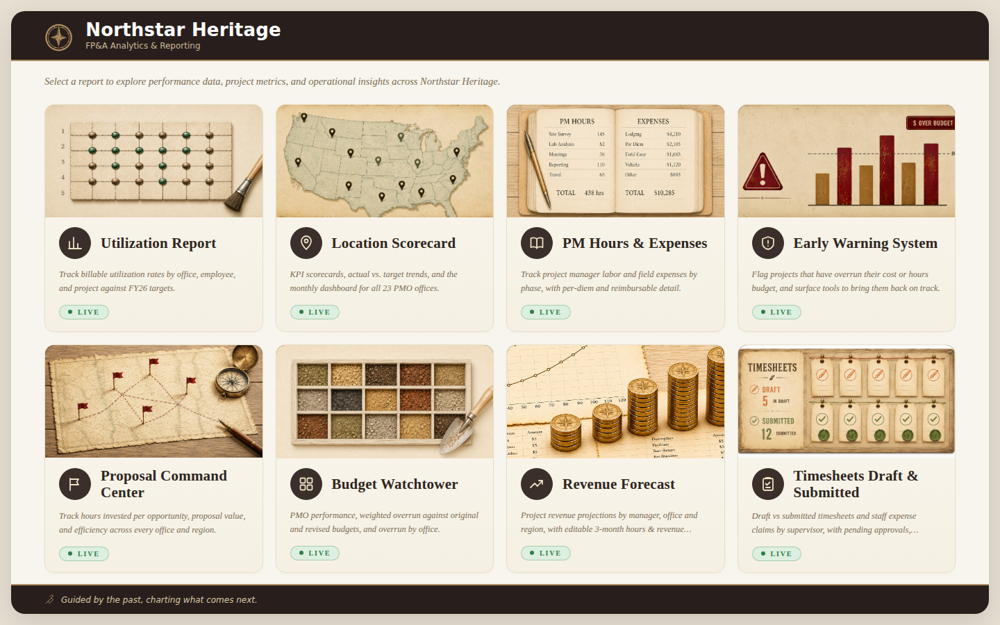

# Northstar Heritage — FP&A Analytics Suite (demo)

A static, file-based FP&A reporting site for a mid-sized professional-services firm: utilization,
budget control, project risk, revenue forecasting, proposal efficiency, approvals and office
scorecards, rebuilt every week from ERP/CRM exports by a set of Python refresh pipelines.

**Northstar Heritage is fictional.** Every name, project, client, office and number in this
repository comes from a seeded synthetic data generator (`tools/`). The dashboards, pipelines and
calculations are the real ones from a production FP&A site, with all company data removed.



## What's in it

| Dashboard | What it answers | Refresh |
|---|---|---|
| **Utilization Report** (`index.html`) | 16-tab hub: PMO & Employee dashboards with generated observations and office backlog, weekly/monthly PMO utilization vs target, employee heat-map grid, overtime, non-posting, PTO, proposal & fleet hours, part-time and on-call trends, one-click styled Excel export | weekly |
| **Budget Watchtower** | Weighted budget overrun on original vs revised (ETC) budget, PMO ranking, project drill-down, late-stage compliance, week-over-week deltas, companion-entity (SAR) merge, downloadable workbook | weekly |
| **Timesheets & Expense Approvals** | Draft/Submitted timesheets and expense reports more than 10 days outstanding, by supervisor and PMO | weekly |
| **Early Warning System** + **Projects (Recovery Builder)** | Projects over budget/hours tiered Critical/Warning/Watch, geographic risk map, task-level budget detail, recovery-plan builder | monthly |
| **PM Hours & Expenses** | Labor and field expenses by PM, project, phase and category for the Central & Mountain (CM) region; opens in the dark "Model X" theme | monthly |
| **Proposal Command Center** | Proposal hours per opportunity by office and month, pipeline value, regional roll-ups | monthly |
| **Revenue Forecast** | Editable 3-month revenue/hours forecast per project seeded from burn rate and backlog | monthly |
| **Location Scorecard** | Per-office revenue, gross profit, net income, utilization, backlog, pipeline and win rate vs plan | monthly |

More screenshots: [docs/screenshots](docs/screenshots).

## Quick start

```bash
# just look at it
python3 -m http.server -d site 8000        # then open http://localhost:8000

# rebuild everything from the synthetic sources (≈3–4 minutes)
pip install -r requirements.txt
python3 tools/build_demo.py                # --rebuild-world to regenerate the company from its seed
```

The pages are plain HTML/JS with no server; Chart.js, SheetJS (xlsx-js-style) and Google Fonts
load from public CDNs.

## How it works

```
ERP / CRM exports (demo_data/…/9.29.2026/<dashboard>/)      ← tools/gen_*.py write synthetic versions
        │
        ▼
pipeline/*.py  (one refresh pipeline per dashboard; self-checks, reconciliation, freshness guards)
        │
        ▼
site/  (static pages + generated data files: *_data.js, raw_data.js, …)
```

- **Merge-based refresh.** The hub's hand-built design is never regenerated: the pipeline renders
  fresh data sections and splices them into the live page (`merge.py`), so design work survives
  every data refresh.
- **Self-checking pipelines.** e.g. the reduced (billable-adjusted) utilization export recomputes
  the workbook's own weekly/monthly figures cell-for-cell and refuses to write on any mismatch; the
  backlog panel refuses to deploy if listed rows don't tie to the headline; a freshness check
  fails the refresh if export side-car files fall behind the page.
- **Reproducible dates.** Every "today"-dependent script honours `FPA_AS_OF`, so the demo always
  builds as of 26 Sep 2026.

Details: [docs/ARCHITECTURE.md](docs/ARCHITECTURE.md) · [docs/REFRESH_WORKFLOWS.md](docs/REFRESH_WORKFLOWS.md) ·
[docs/DATA_MODEL.md](docs/DATA_MODEL.md)

## The synthetic company

`tools/demo_world.py` builds one consistent company from a fixed seed — 26 offices/PMOs, ~350
active staff (730 incl. leavers), ~1,200 projects, ~2,100 opportunities, 81k daily timesheet
entries and ~3,000 expense reports — and every export is derived from it, so figures agree across
dashboards. Relationships are modelled rather than randomised independently: field-season
seasonality, holiday and summer PTO, headcount growth, persistent office and PM effects, costs
rolled up from hours × cost rates, margins by billing type and sector, revenue by % complete or
billed hours, and totals that are always sums of their parts. See
[docs/DATA_MODEL.md](docs/DATA_MODEL.md).

## Repository layout

| Path | Contents |
|---|---|
| `site/` | the deployable static site (GitHub Pages-ready) |
| `pipeline/` | refresh scripts, one set per dashboard |
| `demo_data/` | synthetic weekly/monthly source package + a regression fixture |
| `tools/` | the synthetic world, per-export generators, `build_demo.py` |
| `docs/` | architecture, data model, refresh workflows, screenshots |

## Notes

- Card illustrations on the hub are AI-generated artwork.
- Built with Python 3.10+ (openpyxl, python-calamine); `weekly_summary.py`'s optional Word summary
  needs Node and the `docx` npm package.
